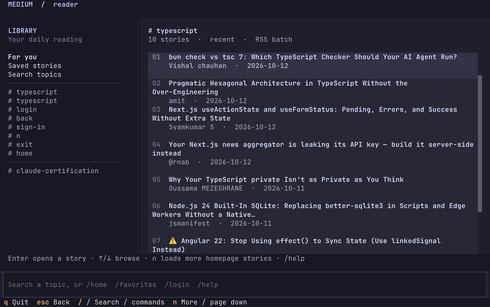
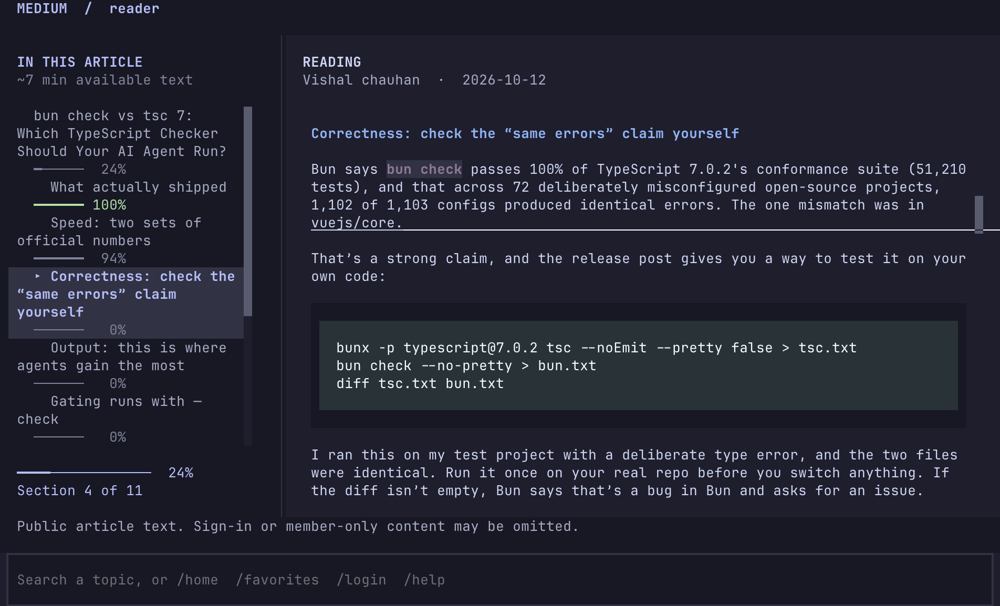

# Medium Reader

An easy-to-read Medium article feed in your terminal. This TUI (terminal user
interface) lets you browse topics, open articles with a heading outline, keep
your reading position, and copy paragraphs straight into your notes.

Topic search works without an account. Connect Chrome to browse your personalized
homepage and saved stories. This is an independent reader, unaffiliated with Medium.

## Start here

Requires **Python 3.10+**, Git, and a terminal such as Ghostty. On macOS or Linux,
paste these commands into your terminal for the first installation:

```sh
git clone https://github.com/bobgravity1/medium-tui.git
cd medium-tui
./install.sh
./medium-reader login
```

**Already installed? Your everyday start command is:**

```sh
cd /path/to/medium-tui
./medium-reader login
```

Replace `/path/to/medium-tui` with the folder where you cloned the project.
If your terminal is already in that folder, run just `./medium-reader login`.
You do not need to activate Python or run the installer every time.

### Connect Chrome (one-time extension setup)

The start command opens the reader and a **Connect Medium Reader** browser page.
Use **your normal Chrome window** for the following steps. If that page opened
in another browser, copy its **full address** from the address bar and paste it
into Chrome first. Keep the terminal reader running while you connect.

1. In Chrome, type `chrome://extensions` in the address bar.
2. Turn on **Developer mode** at the top right.
3. Click **Load unpacked**.
4. On macOS, press **⌘⇧G (Command–Shift–G)** in the folder picker. Paste the
   **full extension-folder path shown on the Connect Medium Reader page**, then
   press **Return**. On Linux or Windows, navigate to that folder in the picker.
5. Click **Select** (or **Open**, if that is the button shown).
6. Return to the **Connect Medium Reader** tab in Chrome, reload it with
   **⌘R** on macOS or **Ctrl+R** on Linux/Windows, and click
   **Connect and open Medium**.

The folder is `src/medium_reader/chrome_extension` inside your project checkout.
Select that folder, rather than the whole project or `manifest.json`.
“Load unpacked” means Chrome loads the extension's files directly from your
computer. Leave the folder in place after installing it.

Sign in to Medium if prompted, then return to the terminal. Your homepage loads
automatically. Keep the connected Medium tab open while using `/home` or
`/favorites`.

**Next time:** run `./medium-reader login` and click **Connect and open Medium**.
You install the extension once; each reader run gets a new connection. Your
Medium sign-in normally stays saved in Chrome.

### Search and read

Click the command field at the bottom, type a topic such as `postgres`, `python`,
or `machine learning`, and press **Enter**. You can also enter
`/search postgres`. Search returns the recent stories in Medium's topic feed;
it does not search the entire Medium archive.

Use **↑/↓** to select a story, **Enter** to open it, and **Esc** to return to the
feed. While reading, select a heading in the left pane to jump to that section.
Your reading position is saved when you leave or quit and restored on reopening.
Enter `/home` for recommendations, `/favorites` for saved stories, or `/quit`
to exit.

To edit the search field, **click and drag across its text** to select it, then
press **Backspace** to delete the selection or type to replace it. Drag without
holding Shift here so the selection belongs to the input field.

**Topic search works without Chrome or an account.** Run `./medium-reader` to
search without opening the connection page, or open a topic directly:

```sh
./medium-reader search postgres --pick
```



### Copy a paragraph and paste it anywhere

Open an article and **click a paragraph** to copy the whole paragraph as plain
text. The paragraph briefly highlights and **Copied** appears at the bottom
right. Switch to your notes, editor, or another app and press **⌘V** on macOS
(or **Ctrl+V** on Windows/Linux) to paste.

For a smaller selection, hold **Shift** while dragging to use your terminal's
text selection, then use its normal Copy command. If the reader shows **Copy
sent** instead of **Copied**, it has asked the terminal to handle the clipboard;
whether that succeeds depends on the terminal's clipboard settings.



### What content is available?

The extension supplies homepage and saved-story cards. Articles are read using
public Medium pages and RSS feeds, so member-only stories may show a preview.
To read the full paid story, open its original URL on Medium with your membership.
The reader does not unlock member-only text.

### Open source

Licensed under the [MIT License](LICENSE). You can use, modify, and redistribute
the project, including commercially; keep the license notice with copies.

### Windows setup

Use PowerShell from the directory where you want the project:

```powershell
git clone https://github.com/bobgravity1/medium-tui.git
cd medium-tui
py -3 -m venv .venv
.\.venv\Scripts\python -m pip install -e .
.\.venv\Scripts\medium-reader login
```

For later runs, use `.\.venv\Scripts\medium-reader login` from that project
folder. Follow the Chrome setup above to connect your account.

## Technical details and command reference

The sections below explain Python setup, the browser connection, command-line
options, local caching, and development.

## What the Python setup does

Python is the program that runs this app, like Node runs a JavaScript app.
You do not need to learn Python or type Python code to use the reader.
Python 3.10 or newer must already be installed; `python3 --version` checks it.

`install.sh` creates a `.venv` folder inside this project. Think of that folder
as this app's private Python runtime environment and installed dependencies.
`pip`, Python's package installer, installs the libraries listed in
`pyproject.toml` there; it fills the role that npm plays for a JavaScript project.
The installer needs internet access to download any missing packages.
It installs this project in editable mode, so Python reads the source in `src/`
directly. Source changes take effect when you restart the app. Rerun the installer
when the dependency list changes.

`./medium-reader` is a small shell launcher. It finds this project's `.venv`
and starts the app with that environment. **You do not need to activate the
virtual environment when using this launcher.** The `./` means “run the file
in my current directory.” From another directory, use its full path:

```sh
/absolute/path/to/medium-tui/medium-reader
```

The installer does not change your shell configuration or system Python.
`.venv` holds dependencies; your cached stories and reading positions live in a
separate OS cache directory described below.

## Connect Chrome once, then connect each reader session

The extension is a small JavaScript helper included in this project. It runs
inside Chrome because Chrome already knows which Medium account you signed in
to. The terminal app cannot see that browser login by itself. The helper reads
rendered story cards from the connected Medium tab and sends them to the terminal
app through a temporary local connection. It does not send your cookies or
password to Python. It is a custom project extension, not an official Medium
extension or a separate download from the Chrome Web Store.

Follow the [one-time Chrome setup](#connect-chrome-one-time-extension-setup)
at the top of this README.

**Each time you start the reader and want your account feed:**

1. Run `./medium-reader login` in the project directory. If the reader is
   already open, enter `/login` in its bottom command field instead.
2. A connection page opens in your system's default browser. If that browser
   is not Chrome, copy the **full address** from its address bar into Chrome,
   where you installed the extension. Keep the reader running.
3. Click **Connect and open Medium**. This connects that tab to the running
   reader and takes the tab to Medium.
4. Sign in to Medium if prompted. If Chrome is already signed in, no new
   sign-in is needed. Return to your terminal; your homepage loads automatically.
5. Keep the connected Medium tab open. Use `/home` for recommendations or
   `/favorites` for saved stories.

You install the extension only once. You reconnect on each reader launch because
the terminal app creates a fresh local connection for that run. Your Medium
sign-in normally stays in Chrome between runs. There is no separate Python server
command to start: the reader starts and stops its local connection itself.
`/logout` disconnects the reader while leaving Medium signed in in Chrome.

### If startup or connecting does not work

| What you see | What to do |
| --- | --- |
| `Run …/install.sh first` | Run `./install.sh` from the project folder. |
| Python is missing or too old | Install Python 3.10+ and rerun the installer. If another interpreter is installed, select it with `PYTHON=python3.12 ./install.sh`. |
| `command not found: medium-reader` | Use `./medium-reader` from this project or its full path. |
| No Connect button | Open the connection page in Chrome, check that the extension is enabled, then reload that page. |
| An old connection page no longer works | Enter `/login` in the running reader and use the new page. Old pages belong to earlier sessions. |
| Reader says Chrome did not respond | Keep the paired Medium tab open, refresh it, and retry. Use `/login` to reconnect if needed. |
| Extension changed after an update | Click its Reload button at `chrome://extensions`, restart the reader, and connect again. |
| A paid article shows only a preview | Read the original article in Medium with your membership. The extension supplies feed cards, not full paid article text. |

## Optional installation methods

The local launcher above is enough for normal use. To make the bare command
available in your **current terminal session**, activate the environment:

```sh
source .venv/bin/activate
medium-reader
```

Activation changes which Python and commands that shell finds. It does not start
the app. Closing the terminal ends activation; `deactivate` also undoes it.

For a permanent command on your PATH, install this directory using either
[pipx](https://pipx.pypa.io/stable/installation/) or
[uv](https://docs.astral.sh/uv/guides/tools/):

```sh
pipx install .
# Alternatively:
uv tool install .
```

Both `medium-reader` and `medium-tui` are equivalent commands. These alternative
installs copy the package; reinstall or upgrade them after project changes.
The package has not been published to PyPI; install from this directory.

On Windows PowerShell:

```powershell
py -3 -m venv .venv
.\.venv\Scripts\python -m pip install -e .
.\.venv\Scripts\medium-reader
```

## Visual reader

When run from a terminal, the interactive reader opens a two-pane interface:
library navigation is on the left and feed stories are on the right. Opening
an article replaces library navigation with its heading outline and shows the
article on the right.
That outline tracks your reading position, shows section-level progress, and
lets you jump directly to a section. Your place is saved locally for each
article and restored when you reopen it.

```sh
# Open the visual reader. A Medium account is only needed for /home and /favorites.
./medium-reader

# Open a topic directly in the visual reader.
./medium-reader search postgres --pick

# Keep the earlier line-based prompts instead.
./medium-reader --classic
```

Use the arrow keys or `j`/`k` to move, `Enter` to open a story or heading,
`Tab` to switch panes, `n` for more homepage stories (or page-down while
reading), `g`/`G` for the beginning/end, `w` to hide or show the sidebar, and
`Esc` to go back. Press `/` to enter a topic or one of the commands below:

```text
/home  /favorites  /search TOPIC  /recent  /popular
/login  /done  /logout  /back  /quit  /help
```

The visual interface uses muted Catppuccin-style colors and needs a terminal
that supports color and Unicode, including Ghostty. Non-interactive commands,
redirected output, and `--classic` retain the original plain CLI behavior.

Click a paragraph in an article to copy the whole paragraph as plain text.
It briefly becomes lighter and “Copied” appears at the bottom right. The reader
uses the native clipboard on macOS/Windows or `wl-copy`/`xclip` on Linux. If no
native clipboard tool is available, it sends an OSC 52 clipboard request to
the terminal and reports “Copy sent”; terminal policy determines whether that
request is accepted. Hold Shift to use your terminal's own text selection.

## Search and read

```sh
# A topic is a Medium tag. Spaces are converted to hyphens.
medium-reader search "machine learning"
medium-reader search web development --limit 5

# Filter the stories supplied by that topic's feed.
medium-reader search python --contains postgres

# Choose a numbered story without leaving the search command.
medium-reader search design --pick

# Numbers refer to the most recent search, even across terminal sessions.
medium-reader read 1
medium-reader read 2 --pager

# Read a public Medium article directly; replace the example URL.
medium-reader read 'https://medium.com/@author/story-title-ARTICLE_ID'

# Save a Markdown copy; existing files are protected unless --force is supplied.
medium-reader read 1 --save article.md

# Script-friendly output; diagnostics go to stderr.
medium-reader search python --json
medium-reader read 1 --format json
medium-reader read 1 --format markdown > article.md
medium-reader read 1 --format plain

# Read previously fetched content without network requests.
medium-reader search python --offline
medium-reader read 1 --offline
```

Run `medium-reader` with no arguments for the visual reader. Enter a topic,
then select a story with the arrow keys and Enter. Esc returns to your feed;
q exits. `--classic` uses the earlier numbered prompts and terminal pager.
With redirected input/output, the bare command prints help instead of waiting
for input. `--pick` requires an interactive terminal.

## Browse your personalized homepage

Start `./medium-reader login`. This opens your system's default
browser. With Chrome as your default, it uses your normal Chrome account and
your existing Medium sign-in. Enter `/home` for your personalized feed or
`/favorites` for saved stories. Enter a topic normally for public RSS search.

You can also open the homepage directly from Ghostty:

```sh
./medium-reader home
```

The Chrome connection uses a **custom extension included in this project**,
not an official Medium extension. Follow the
[one-time extension setup](#connect-chrome-once-then-connect-each-reader-session)
above, including the shortcut for finding its folder on macOS.

When updating the reader, use the extension's Reload button in
`chrome://extensions`, restart the reader, and enter `/login` again. Version
0.4.2 binds a connection to one browser tab at a time. Reconnecting from a
different tab replaces the previous connection, so another account's tab cannot
silently keep supplying feed cards. `/login` opens the browser every time;
you only need to sign into Medium when Chrome is actually signed out.

Keep the connected Chrome tab open while browsing. It exports only rendered
story cards through a local connection with a fresh token for this reader run.
Passwords and cookies remain in Chrome; the extension has no cookie, debugger,
or broad browsing-history permissions. `/done` remains available for a manual
connection check, but the visual reader normally detects completion itself.
Each new reader process needs a new connection; Chrome's Medium login persists.
Standalone `home --list`/`home --json` and `favorites --list`/`favorites --json`
can connect when started with interactive terminal input. They open the browser,
wait up to three minutes for Connect and Medium sign-in, then print the result.
Connection instructions go to stderr so JSON stdout stays valid. Unattended runs
with non-terminal input exit with an actionable error; use `--offline` for cached
cards in scripts. `/logout` disconnects this reader and
clears its feed lists without signing your account out of Chrome or ego-lite.

In the visual reader, select a story with the arrow keys and Enter; Esc returns
to the feed. `n` loads more homepage cards and `/recent` or `/popular` sorts the
loaded stories. Topic RSS feeds show a fixed batch. `--classic` uses the older
numbered pages, `n`/`p` paging, and a pager where `q` returns to the feed.

```sh
./medium-reader home --page-size 5
./medium-reader home --list --limit 20
./medium-reader home --json --limit 20
./medium-reader home --offline
./medium-reader favorites
./medium-reader logout
```

`--offline` lists the last fetched homepage cards without opening a browser.
An offline article must have been read and cached previously; a card alone does
not contain the story. Your homepage is cached separately from topic results.
`read 1` refers to the latest displayed search or homepage list. `--limit` applies
to one-shot `--list`/`--json` output; interactive browsing loads more on demand.
`/favorites` reads your default Medium Reading list in the connected reader.
`/logout` disconnects it. While browsing, `/recent`
sorts by the available publication dates and `/popular` sorts by visible clap
counts. Ranking is only possible when Medium includes that metadata in the cards.

This feature personalizes discovery. Opening a story still uses the existing
public article/RSS reader, so a homepage recommendation can lead to a
member-only preview. Homepage markup and loading behavior are controlled by
Medium; if it changes, the reader reports an error rather than substituting a
public or unrelated feed.

## What “search” and “read” mean here

Topic search uses Medium's documented `https://medium.com/feed/tag/TOPIC` RSS
endpoint. It returns the recent stories Medium includes in that feed; it is not
a full-text search of Medium's archive, and there is no feed pagination.
`--limit` caps the displayed results; it cannot retrieve more than the feed
supplies. In interactive search, `n` and `p` move through the available results;
`n` reports when Medium has no additional page to load. `/recent` sorts by feed
dates. `/popular` works only when the result source exposes clap counts.
`--contains` searches only the fetched titles and available text.

RSS is the interface Medium provides for reading its stories in other apps.
Using it avoids depending on Medium's private search API or browser markup for
topic discovery. Topic feeds often supply only a snippet. Selecting one of those results fetches
the public article page automatically. If Medium blocks the page, the reader
tries the author’s documented RSS feed when the URL identifies the author. If
only a cached snippet is available, it displays an explicit preview notice.

Medium says member-only stories are **not available in full through RSS**.
The reader labels feed content as possibly excerpted, and labels detected
member-only web pages as public previews. It does not sign in, access account
cookies, or unlock paid stories. Read the original URL on Medium for content
that requires your membership. Images appear as their supplied alt text;
interactive embeds are omitted. Code blocks and headings are retained.

Direct URL fetching supports `medium.com` and `*.medium.com`. Custom-domain
stories can be read from the content supplied in a topic feed by their result
number. Direct requests redirected to another domain are rejected. Medium may
block automated article-page requests even when its RSS feeds work; in that
case, try finding the story by topic instead. HTML extraction depends on
Medium's page structure and may need future maintenance.

Reference: [Medium's official RSS documentation](https://help.medium.com/hc/en-us/articles/214874118-Using-RSS-feeds-of-profiles-publications-and-topics).

## Cache and configuration

The local SQLite cache contains fetched article content, topic results,
personalized homepage card metadata, and the last displayed result list. A successful search stores the entire returned feed,
then applies your display filter. A new displayed list replaces the result
numbers. Search fetches fresh data unless `--offline` is supplied. Reading uses
cached article text when present; snippets trigger an article fetch unless
`--offline` is supplied. `read --refresh` requests the article again, falling
back to its author feed if available. A search failure is reported instead of silently showing stale results. If an
article fetch fails, an available cached preview is displayed with the reason;
`--refresh` reports an error if neither the page nor author feed supplies it.

The default directory follows your OS's cache convention through `platformdirs`:
`~/Library/Caches/medium-reader` on macOS,
`~/.cache/medium-reader` on Linux, and the local application cache on Windows.
Override it with `--data-dir /path/to/cache` or `MEDIUM_READER_HOME`.
The cache has no automatic expiry; delete its `reader.sqlite3` file while the
reader is closed to clear it.

`--timeout 30` changes the network timeout (default 20 seconds, maximum 120).
`--no-color` or the `NO_COLOR` environment variable disables colors. Read output
defaults to styled text in a terminal and Markdown when piped. `--format plain`
renders Markdown as plain terminal text. `--format json` emits article metadata
and the Markdown body. Network failures, blocked pages, missing results, and
file errors exit with status 1; invalid arguments exit with status 2; Ctrl-C
exits with status 130.

No telemetry or global browser configuration changes are made. Homepage browsing
uses the connected Chrome extension; topic search and article reading use HTTP. HTTP
responses are bounded to 8 MB, XML entities are disabled, and remote control
characters are removed before rendering. HTTP article requests stay on Medium
domains. The sign-in UI may take you to the identity provider you choose.

## Develop and test

```sh
./install.sh --dev
.venv/bin/python -m pytest
.venv/bin/ruff check .
.venv/bin/ruff format --check .
node --test tests/test_extension.js
```

Tests use synthetic RSS and HTML plus mocked HTTP requests; they do not depend
on Medium being reachable. Chrome bridge tests open temporary loopback ports.
The separate JavaScript suite uses Node's built-in test runner to exercise the
extension's actual login/polling/message handlers with synthetic browser state.
It does not launch Chrome or inspect your accounts. The installer uses editable
mode, so source edits are available on the next run. Rerun `./install.sh --dev`
when dependencies change. You can also install editable mode directly:

```sh
.venv/bin/python -m pip install -e '.[dev]'
```

The modules separate the request lifecycle into three small steps: `core.py`
fetches and parses content, `storage.py` remembers it, and `cli.py` handles commands
and rendering. `home.py` parses rendered feed cards and retains the legacy ego-lite
adapter; `chrome.py` provides the current Chrome connection. Tests exercise the
local bridge with synthetic cards and leave your real accounts signed in.

For a live Chrome check, reload the custom extension and restart the reader.
Enter `/login`, click Connect, and confirm that `/home` shows the intended
account's recommendations and `/favorites` shows its Reading list. Close the
connected tab to check recovery, then use `/login` to reconnect. `/logout`
must disconnect the reader while leaving Medium signed in in Chrome. A paid
Medium account still uses the public article reader; member-only article text
is not unlocked by this feed connection.

To uninstall the local installation, remove this project's `.venv` directory.
For a pipx/uv installation, use `pipx uninstall medium-tui` or
`uv tool uninstall medium-tui`. Cached articles are stored separately.
